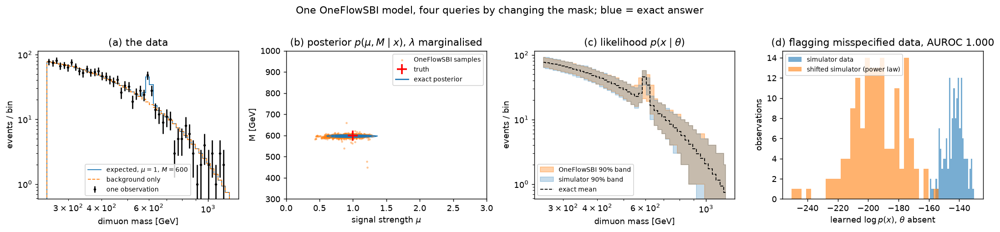

# One model for a bump hunt

A toy collider search with an exact likelihood, and one masked flow matching model
([OneFlowSBI](https://arxiv.org/abs/2601.22951)) trained to answer every question the
search asks: the posterior, the likelihood, the posterior with part of the detector
missing, and a score for data the simulator never produced. Each answer is compared
with the exact one.

The write-up, with interactive results, is at **https://liju666.com/bump_hunt/**.



## The toy

Dimuon invariant masses from two sources: a Drell-Yan background with an exponential
spectrum and a $Z'$ signal with a Gaussian peak at mass $M$. Parameters
$\theta = (\mu, M, \lambda)$: signal strength, mass, and the background decay scale as a
nuisance. Events are Poisson-distributed, cut to a mass window and histogrammed into 48
log-spaced bins. Because of Poisson thinning the bin counts are independent Poisson
variables with closed-form means, so the posterior, the evidence, and the posterior given
only some of the bins are all available exactly by summation on a grid. A second simulator
with a power-law background provides data outside the model, for the flagging test.

## Run it

Python 3.14 and [uv](https://docs.astral.sh/uv/). Dependencies (numpy, scipy, torch,
matplotlib, markdown) are installed from `pyproject.toml` on the first `uv run`.

```
uv run python minimal.py                                         # toy self-check and figure
uv run python scripts/train.py --budget 30000                    # train, ~4 min with early stopping
uv run python scripts/demo.py --run runs/b30000_s0               # static four-panel figure
uv run python scripts/export_interactive.py --run runs/b30000_s0 # precompute data for the page, ~8 min
uv run python scripts/build_site.py                              # docs/post.md -> site/index.html
```

A trained model is included (`runs/b30000_s0/model.pt`), so the last three commands work
without training. Open `site/index.html` directly in a browser, or serve it with
`python3 -m http.server` from the `site/` folder.

## Layout

```
oneflow/
  simulator.py      the toy: prior, simulator, exact Poisson likelihood
  reference.py      exact (mu, M) posterior and evidence on a grid, with or without absent bins
  data.py           dequantisation, log1p, standardisation, and their inverses and Jacobians
  masks.py          ternary query masks and the training mixture
  model.py          residual MLP velocity field with adaptive layer norm on the time embedding
  train.py          masked flow matching, validation-based early stopping, EMA weights
  flow.py           masked sampling (Euler) and log densities (RK4 with exact divergence)
  evaluate.py       AUROC
scripts/
  train.py                 simulate a training set and train one model
  demo.py                  the four-panel figure in results/demo.png
  export_interactive.py    precompute the scenarios the page shows
  build_site.py            Markdown post + page template + data -> site/index.html
  site_template.html       page shell, styles, the interactive explorer and its script
  mechanism.html           the collision-to-histogram figure (inline SVG + script)
  architecture.html        the network figure (inline SVG)
docs/post.md               the write-up, Markdown with $...$ math
site/index.html            the built page, published by .github/workflows/pages.yml
minimal.py                 self-check of the toy against its own likelihood
```

## References

- Nautiyal, Ju et al. *OneFlowSBI: One Model, Many Queries for Simulation-Based Inference.* arXiv:2601.22951, 2026.
- Lipman et al. *Flow Matching for Generative Modeling.* ICLR 2023.
- Cranmer, Brehmer, Louppe. *The frontier of simulation-based inference.* PNAS 2020.
